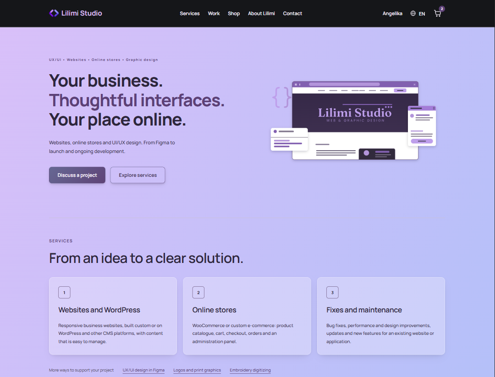

# Lilimi Studio

A full-stack application combining a digital embroidery shop, embroidered products and custom service inquiries.

I am building Lilimi Studio for my own planned business. I design the interface and develop the Angular frontend, Spring Boot backend, database, tests and deployment infrastructure.

[Live demo](https://lilimistudio.com) · [Technical guide](docs/PROJECT_GUIDE.md) · [Recovery procedures](deploy/RECOVERY.md)



> Demo application under active development. Stripe sandbox payments and digital ZIP delivery are available on the public demo. No real money is charged. Physical order fulfilment and refunds are not automated. Use Stripe test payment details and an email address you control.

## Main features

- Responsive Polish and English studio website with service pages and project inquiry forms.
- API-backed catalogue, garment configuration and a persistent cart supporting digital and physical products.
- Server-priced checkout with saved order snapshots and protection against duplicate submissions.
- Customer accounts with email verification, password recovery, saved profiles and order history.
- Stripe sandbox integration with hosted Checkout, payment resumption, verified webhooks and cancellation handling.
- Administrator tools for orders, inquiries, product translations, visibility, prices and garment variants.
- Product image galleries with uploads, replacement, primary image selection and persistent filesystem storage.
- Private, versioned digital ZIP packages; each purchased digital item retains its assigned package version.
- Downloads after confirmed payment, from the payment result page, customer order details or an emailed link without signing in.
- Download links expire after seven days. Resend requests use CSRF protection, per-source rate limits and a per-order cooldown; earlier links keep their original expiry dates.
- Order and inquiry work queues with filters, search, archive views, per-administrator read tracking and URL-preserved navigation.

## Technology

| Area | Stack |
| --- | --- |
| Frontend | Angular 22, TypeScript, signals, RxJS, SCSS, Transloco, SSR |
| Backend | Java 21, Spring Boot 4, Spring Security, Spring Data JPA |
| Database | PostgreSQL 17, Flyway |
| Testing | Vitest, Angular TestBed, JUnit, MockMvc, Testcontainers |
| Delivery | GitHub Actions, Docker Compose, GHCR, AWS Lightsail, Caddy |

## Selected engineering decisions

- **The server owns pricing.** Orders retain snapshots of purchased products, configurations and prices.
- **Retries must not duplicate operations.** Order submission and Stripe session creation use idempotency keys.
- **Payment confirmation comes from verified webhooks.** Browser redirects cannot mark an order as paid; webhook deduplication and payment updates share a transaction.
- **Email delivery can be retried.** Payment confirmation and the download-email queue entry commit together. Workers process persisted queue entries with bounded retries. SMTP delivery is not atomic with the database commit, so a failure can result in a duplicate email.
- **Download access is checked on every request.** Session ownership or an expiring token is required, together with confirmed payment, a non-cancelled order and an item belonging to that order. Raw download tokens are not stored in the token table.
- **A product update does not replace a purchased file.** Downloads use the package version pinned to the order item, rather than the latest upload.
- **Tests use PostgreSQL.** Integration tests exercise migrations, constraints and concurrency against Testcontainers databases.
- **Deployments use verified commits.** CI runs tests, dependency audits and image scans before publishing images tagged with the full commit SHA.

## Digital purchase flow

1. Checkout calculates prices on the server and snapshots the purchased items and digital package versions.
2. The buyer completes a Stripe sandbox Checkout session.
3. A verified webhook confirms payment and queues the download email in the same database transaction.
4. A worker issues a seven-day token and sends a Polish or English email through the configured SMTP provider.
5. The email link opens a download page that works without the original checkout session. The browser passes the token to the API in a header.

A resend form accepts the order reference and checkout email, returning the same acknowledgement whether or not the details match. The default cooldown is five minutes per order, with five requests per source address per 15 minutes. Existing links remain valid until their original expiry.

## Run locally

Prerequisites: Node.js 24, npm, JDK 21 and Docker with Linux containers.

For development, run Angular and Spring Boot separately with PostgreSQL and Mailpit. The technical guide includes first-time configuration, startup commands and local Stripe testing:

[Local development setup](docs/PROJECT_GUIDE.md#run-locally)

### Local API documentation

Start the backend with the `local` Spring profile, then open
[Swagger UI](http://localhost:8080/swagger-ui.html). The OpenAPI JSON is available
at [localhost:8080/v3/api-docs](http://localhost:8080/v3/api-docs).

To try the API without signing in, run `GET /api/products`. For an example
that requires order access, see the endpoints for listing downloadable files
and downloading a ZIP from a paid order.

Swagger UI and the OpenAPI endpoints are disabled by default and enabled
in the local configuration.

## Verification

Frontend, from the repository root:

```powershell
npm test -- --watch=false
npm run build
npm audit --audit-level=high
```

Backend, from `backend`, with Docker running:

```powershell
.\mvnw.cmd verify
```

## Design and implementation

The project covers both interface design and implementation. README screenshots are captured from the deployed application; the initial Figma designs and user flows may reflect earlier development stages.

[Mobile homepage](docs/screenshots/home-mobile.png) · [Product configurator](docs/screenshots/configurator-desktop.png) · [Cart](docs/screenshots/cart-desktop.png)

- [Code tour](docs/PROJECT_GUIDE.md#code-tour)
- [Architecture](docs/PROJECT_GUIDE.md#architecture)
- [API](docs/PROJECT_GUIDE.md#api)
- [Deployment](docs/PROJECT_GUIDE.md#deployment)

## Next steps

- Optimize catalogue image loading and introduce appropriately sized thumbnails.
- Refine interface designs and replace remaining sample portfolio content.
- Further payment recovery, refunds and preparation for real payments.
- Physical fulfilment workflows, order status notifications and automated off-host backups.
- Assess multi-instance readiness and test load balancing locally before provisioning additional cloud infrastructure.

[Detailed features and implementation notes](docs/PROJECT_GUIDE.md)
