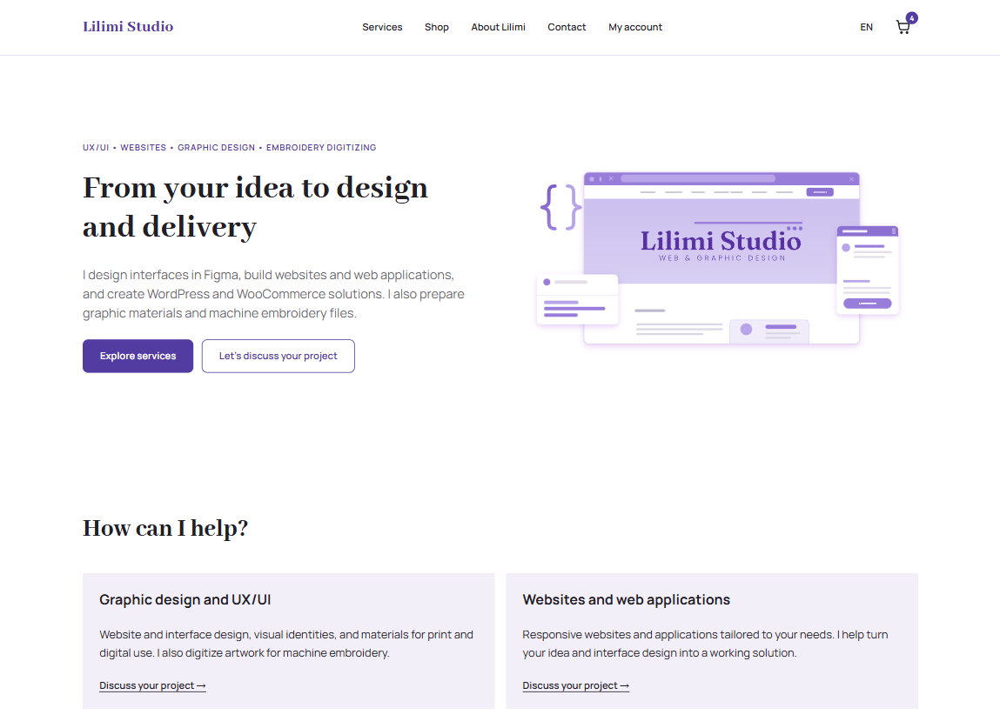
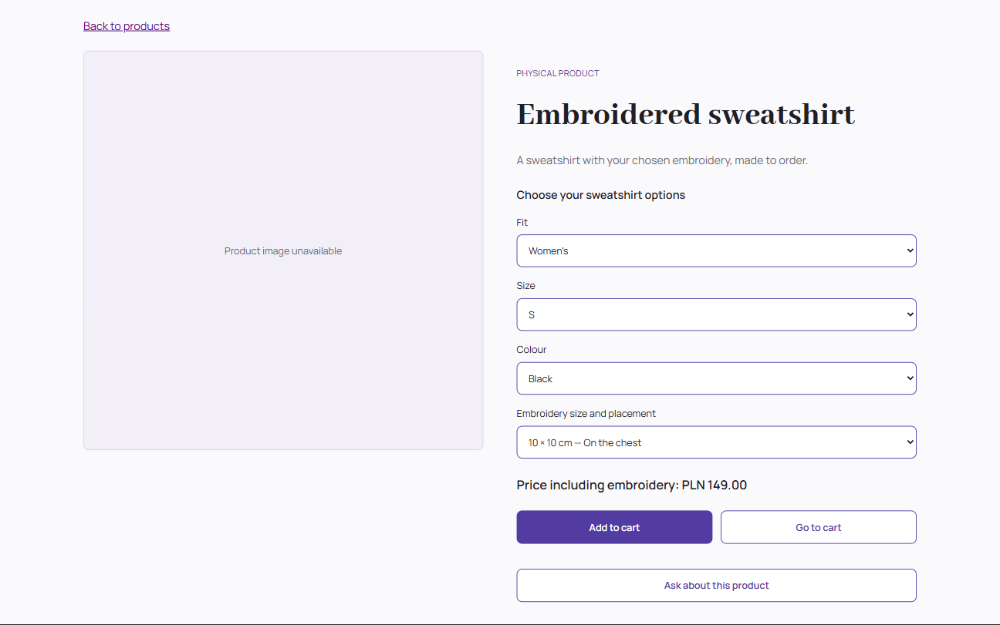
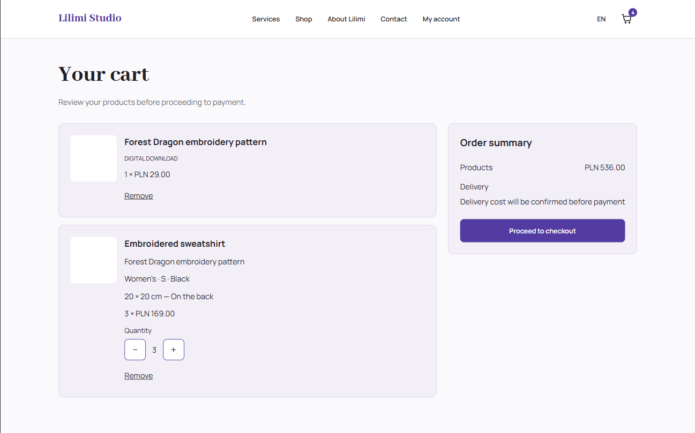
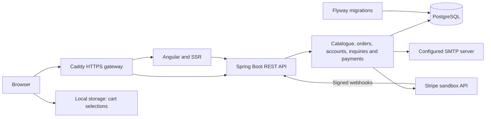

# Lilimi Studio - technical guide

**A full-stack studio website combining digital services, an embroidery shop, and custom project inquiries.**

I am building Lilimi Studio for my own planned business. The studio offers UX/UI and Figma design, web development, WordPress and WooCommerce, graphic design, and embroidery digitizing. The application combines this service offering with a shop for digital embroidery patterns and embroidered products.

I develop both the Angular frontend and Spring Boot backend, including database migrations, integration tests, administrator tools, and deployment on AWS.

Angular 22 · Java 21 · Spring Boot 4 · PostgreSQL 17

[Project overview](../README.md) | [Features](#what-works-today) | [Engineering decisions](#engineering-decisions) | [Architecture](#architecture) | [Run locally](#run-locally) | [API](#api) | [Verification](#verification) | [Deployment](#deployment) | [Next milestones](#next-milestones)

This guide describes the current source checkout. Features on an unmerged branch may not yet be available on the public demo. Configuration examples contain placeholders, never deployment secrets.

> **Demo application under active development.** Orders and project inquiries are stored in the database. The deployed demo uses Brevo for account verification, password reset and order confirmation emails; the local development profile uses Mailpit. Stripe Checkout is implemented and tested in a sandbox; payments are disabled by default and real payments are not supported by the current configuration. Order fulfilment and digital file delivery are not implemented. Use fictional delivery details, an email address you control and Stripe test payment details only.



## What works today

### Studio website

- Responsive homepage, service pages, about page, and contact page.
- Services overview covering UX/UI and Figma, web development, WordPress and WooCommerce, graphic design, and embroidery digitizing.
- Service inquiry links and shared navigation across the header, mobile menu, and footer.
- Polish and English interfaces using Transloco.
- English as the default language for the root URL.
- Responsive navigation with a mobile menu and cart quantity badge.
- Shared layout with a footer that stays at the bottom of short pages.

### Catalogue and cart

- API-backed product catalogue with category filtering, sorting, and a “show more” interaction.
- Product details, file formats, and related products loaded from the backend.
- Sweatshirt configuration by fit, size, colour, and embroidery option.
- Available combinations and variant-specific prices supplied by the API.
- Mixed carts containing digital patterns and physical products.
- Quantity controls, item removal, and persistence across page reloads.
- Loading, retry, and unavailable-item states.
- Saved cart selections preserved during temporary catalogue failures.

### Checkout and orders

- Contact validation and delivery details for physical products.
- Saved customer contact details and delivery address used to prefill checkout.
- Manual entry preserved for guest checkout and when profile loading fails.
- Late profile responses do not overwrite edited fields or change details already being reviewed.
- Digital-only checkout without a delivery address.
- Courier selection and order review.
- Order submission and persistence in PostgreSQL.
- Server-side validation of products, configurations, quantities, and prices.
- Order items stored as snapshots of the purchased configuration and price.
- Idempotency keys to prevent duplicate orders when the same submission is retried.
- Server confirmation with an order reference.
- Cart cleared after a successful submission and preserved when submission fails.
- Polish and English order confirmation emails generated from saved order details.
- Email queue entries committed in the same transaction as new orders.
- Background email processing with PostgreSQL row locking, delayed retries and a five-attempt limit.
- SMTP failures do not roll back submitted orders.

Delivery currently uses fixed demonstration rates for Poland. No real money is collected.

### Payments - Stripe sandbox

- Hosted Stripe Checkout for guest and signed-in customer orders.
- Digital-only and mixed orders, including the saved courier delivery charge.
- Payment amounts and currency taken from the stored order, not supplied by the browser.
- Persisted payment attempts with idempotency keys and protection against multiple active attempts for the same order.
- Payment attempts committed before calling Stripe; network requests run outside database transactions.
- Payment access restricted to the owning account or the guest session that submitted the order.
- Webhook signature verification using the original request body.
- Transactional webhook processing and event ID deduplication.
- Handling for completed, asynchronous success, asynchronous failure and expired Checkout sessions.
- Payment confirmation requires matching order metadata, session, amount, currency and test mode.
- Return page reads payment status from the backend and polls briefly while confirmation is pending.
- Redirect parameters alone never mark an order as paid.
- Checkout payment actions are shown only when payments are enabled by the backend.
- Payment status displayed separately from fulfilment status in customer order history and details.
- Customer order details include a test payment action when the backend allows payment.
- Resuming payment reuses an active attempt and its Stripe Checkout session.
- A new attempt can be started after the previous attempt has failed or expired.
- Concurrent resumption requests share the same active payment attempt.
- Confirmed payment takes precedence over other attempts in order payment summaries.
- Payment summaries for an order history page are fetched in one database query.
- Cancelling an unpaid order queues closure of its active Checkout attempt in the same database transaction.
- Background session expiration uses database leases, delayed retries and a five-attempt limit.
- Stripe network requests run outside database transactions during session expiration.
- Paid orders cannot be cancelled through the ordinary order status update.
- Payments confirmed after cancellation are retained and flagged for administrator review.
- Session closure progress and cases requiring review are visible in administrator order lists and details.
- Session expiration does not issue refunds.

The integration currently accepts sandbox API keys and test-mode events only. Payment status is separate from order fulfilment status. Returning from Stripe without paying does not cancel the order or automatically expire the Checkout session.

Manual sandbox checks cover guest payments, signed-in customer payments with delivery, returning without payment, a declined card followed by a successful retry in the same Checkout session, and 3D Secure authentication. Additional checks cover automatic session expiration after administrator cancellation and rejection of cancellation for a paid order.

Remaining work includes guest payment recovery flows, operational recovery and reconciliation, refunds, and preparation for real payments. Automatic fulfilment and digital file delivery remain outside the current implementation.

### Project inquiries

- Inquiry form for embroidered products, UX/UI and Figma, web development, WordPress and WooCommerce, graphic design, embroidery digitizing, and other projects.
- Service links preselect the project type, which is stored with the inquiry and displayed in the administrator panel.
- Optional product context passed from a product page.
- Frontend and backend validation.
- Optional inspiration URL.
- Inquiries stored in PostgreSQL with a reference returned to the visitor.
- Loading, submission, and error states.

Submitting an inquiry does not create an order or send an email.

### Customer accounts

- Customer registration with frontend and backend validation.
- Password hashing with BCrypt and validation of its 72-byte input limit.
- Email normalization and duplicate-account handling.
- Email verification required for newly registered customers.
- Polish and English verification and password reset emails, using the configured SMTP server (Brevo on the deployed demo, Mailpit locally).
- Expiring, single-use verification and password reset tokens stored as hashes.
- Per-account limits on verification resends and password reset emails.
- Password recovery with invalidation of existing sessions and previously issued reset links after a password change.
- Customer login and logout using server-side sessions.
- Session restoration after a page reload.
- Separate customer and administrator permissions enforced by the backend.
- A profile page with a read-only summary, separate editing mode, cancellation, and confirmation before removing saved details.
- Saved first name, last name, phone number, and an optional default delivery address.
- Version checks to detect conflicting profile updates.
- Checkout prefilled from the customer's profile without overwriting fields already edited by the customer.
- Checkout details remain editable without changing the saved profile.
- Profile changes do not modify previously placed orders.
- New orders associated with the signed-in account, while preserving guest checkout.
- Paginated order history and detailed views of purchased items, prices, and delivery information.
- Backend ownership checks preventing access to another account's orders.
- Polish and English account interfaces.
- Backend and frontend tests covering account flows, access restrictions, validation, profile conflicts, and checkout prefill.

Registration does not sign the customer in automatically. New customers verify their email before signing in. Verification links expire after 24 hours; password reset links expire after 30 minutes.

Order history includes orders placed while signed in; guest orders are not automatically linked by email. Removing saved profile details keeps the account, sign-in email, and previous orders.

### Administrator tools

- Administrator login and logout using server-side sessions.
- Role-based access enforced by the backend.
- Per-administrator read tracking for orders and inquiries, stored in PostgreSQL.
- Unread references and customer names highlighted with bold text and an accessible indicator.
- Successfully loaded detail pages trigger a separate CSRF-protected read operation; fetching a list does not mark entries as read.
- Shared navigation between orders, products and project inquiries, including detail and edit pages.
- Administrator root URLs redirect to the order list.
- Order references link directly to order details.
- Order work queue, archive and all-orders views.
- Cancelled orders with payments requiring review remain visible in the work queue.
- Server-side filtering by order status and creation date, applied before pagination.
- Inclusive date ranges interpreted in the Europe/Warsaw time zone, including daylight saving changes.
- Case-insensitive search by full or partial order reference, customer email or customer name.
- Search treats SQL wildcard characters as literal text.
- A new search phrase selects all orders and clears previous status and date restrictions; results can then be narrowed with filters.
- Selected view, filters, search phrase and page preserved in the URL and when returning from order details.
- Visual status labels emphasise active work and payment cases requiring review.
- Order status updates with validated transitions.
- Optimistic locking to detect conflicting order updates.
- Paginated inquiry list and detailed inquiry views.
- Inquiry work queue, answered, archive and all-inquiries views.
- Filtering by status, service type and inclusive creation dates in Europe/Warsaw.
- Case-insensitive search by full or partial inquiry reference, customer email or name.
- Filters applied before pagination and preserved in the URL and detail navigation.
- A new search phrase clears previous restrictions and searches all inquiries.
- Visual status labels distinguish active, answered and closed inquiries.
- Handling for expired sessions, access errors, and failed requests.
- Inquiry status updates with validated transitions and optimistic locking.
- Paginated product list including active and hidden products.
- Product visibility updates with confirmation and optimistic locking.
- Editing Polish and English product names and descriptions with validation and optimistic locking.
- Editing digital product prices in PLN with validation and optimistic locking.
- Price updates preserve unsaved product translation edits.
- Paginated garment variant list including inactive configurations.
- Editing garment variant prices and availability with validation and optimistic locking.

## A closer look

The shop flow is:

Catalogue → product configuration → cart → checkout → stored order → administrator review



Available garment combinations come from the API. The selected configuration determines the price and is retained in the cart and order.



Digital and physical items share a subtotal. Physical items retain their individual configuration and quantity and require delivery details.


The interface supports mobile browsing, product configuration, checkout, and administrator views.

### Design process

- [UI designs — Figma (Polish)](https://www.figma.com/design/sIEFBWbYgUeox8HFAzdfSK/Lilimi-Studio---UX-UI-Design?node-id=1-2&t=JX1Vs5xUUwrYHqwn-1)
- [Sitemap and user flows — FigJam (Polish)](https://www.figma.com/board/cihOaxBQda1CJVEy0FxpWV/Lilimi-Studio---Sitemap---User-Flows?node-id=0-1&t=cGEjnJFJ3WfLNDon-1)

These files document the initial concept and planned journeys. Some designs and screenshots reflect earlier stages of the application.

## Engineering decisions

| Decision | Reason |
| --- | --- |
| Prices use integer grosz amounts | `14900` represents PLN 149.00, avoiding decimal currency arithmetic. |
| Catalogue and variant prices are separate | A garment's “from” price differs from the price of a selected configuration. |
| Cart selections are separate from fetched product data | Temporary API failures must not erase selections or turn unknown prices into zero. |
| The backend calculates order prices | Order totals do not depend on prices supplied by the browser. |
| Orders store item snapshots | Stored orders retain the product configuration and price used at submission. |
| Order submission uses idempotency keys | Retrying an identical submission can return the existing order instead of creating another. |
| Order updates use optimistic locking | Concurrent administrator updates are detected rather than silently overwriting each other. |
| Authentication uses server-side sessions | Authentication tokens are not stored in browser local storage. |
| Browser state-changing requests use CSRF protection | Session-based requests require CSRF validation; the Stripe webhook POST uses signature verification instead. |
| Payment attempts are stored before contacting Stripe | Provider failures leave an attempt available for retry, without keeping a database transaction open during the network request. |
| Stripe requests use stable idempotency keys | Retrying session creation for the same attempt can reuse the provider operation. |
| Payment confirmation comes from verified webhooks | Browser redirects and query parameters are not evidence of payment. |
| Webhook IDs and payment updates share a transaction | Duplicate events are ignored, while failed processing rolls back both records and permits another delivery attempt. |
| Flyway owns schema changes | Database structure and seed data use versioned migrations. |
| Integration tests use PostgreSQL containers | Database behaviour is tested against PostgreSQL rather than an in-memory substitute. |
| Account action tokens are stored as hashes | Verification and password reset links use expiring, single-use tokens without storing their raw values in the database. |
| Password changes increment a credentials version | Existing sessions and previously issued reset links become invalid after a password change. |
| Customer profiles are separate from order details | Customers can change saved details without changing historical orders. |
| Profile updates include a version | Stale edits are rejected instead of overwriting changes made in another tab. |

## Architecture



| Area | Tools |
| --- | --- |
| Frontend | Angular 22, TypeScript, signals, Signal Forms, RxJS, SCSS, Transloco, Angular SSR |
| Backend | Java 21, Spring Boot 4.1.1, Spring Security, Spring Data JPA, Hibernate, Maven |
| Database | PostgreSQL 17, Flyway |
| Tests | Vitest, Angular TestBed, JUnit, MockMvc, Testcontainers |
| Deployment | AWS Lightsail, Docker Compose, Caddy, HTTPS |

Payment code is grouped by workflow: `checkout` starts and resumes payments, `webhook` verifies and processes provider events, `status` serves payment reads, `access` checks account or guest permissions, and `cancellation` queues and processes Checkout session expiration. Stripe client configuration and API calls live in `stripe`; payment entities and their repository remain in `domain` and `persistence`. Payment tests follow the same package structure. Checkout creation, retrieval and expiration call Stripe outside database transactions. Order confirmation email processing is different: `OrderConfirmationProcessor.processNext()` sends SMTP mail while its queue transaction and row lock are open. Queuing keeps SMTP failures separate from the original order submission, but SMTP delivery is not exactly-once; a successful send followed by a database failure can result in a duplicate email on retry.

## Code tour

- [Product API mapping](../src/app/features/products/product-api.mapper.ts) — mapping backend responses to frontend product models.
- [Cart service](../src/app/features/cart/cart.service.ts) — persistence, availability, and totals.
- [Checkout](../src/app/features/checkout) — order review, submission, and error handling.
- [Order pricing](../backend/src/main/java/pl/lilimi/order/application/OrderPricingService.java) — server-side pricing.
- [Order submission](../backend/src/main/java/pl/lilimi/order/application/OrderSubmissionService.java) — idempotent submission.
- [Administrator order status service](../backend/src/main/java/pl/lilimi/order/application/admin/AdminOrderStatusService.java) — status transitions and version checks.
- [Project inquiry service](../backend/src/main/java/pl/lilimi/inquiry/application/ProjectInquiryService.java) — validation and persistence.
- [Administrator views](../src/app/features/admin) — order and inquiry lists and details.
- [Database migrations](../backend/src/main/resources/db/migration) — schema and seed data.

```text
src/app/
├── core/          # API configuration, authentication and translations
├── features/      # Studio pages, products, cart, checkout, inquiries and admin
├── layout/        # Shared layout and navigation
├── shared/        # Reusable interface components
└── testing/       # Test providers and fixtures

backend/
├── src/main/java/pl/lilimi/
│   ├── auth/      # Customer registration, sessions and administrator account provisioning
│   ├── catalog/   # Products and garment variants
│   ├── customer/  # Saved customer profiles and version-checked updates
│   ├── inquiry/   # Public inquiries and administrator queries
│   ├── order/     # Submission, pricing and administrator operations
│   ├── payment/   # Checkout, webhooks, payment status, access rules and Stripe integration
│   └── security/  # Access rules and CSRF configuration
├── src/main/resources/
├── src/test/java/
├── compose.yaml   # PostgreSQL and Mailpit for local development
└── pom.xml
```

## Run locally

For development with separate frontend and backend processes, install **Node.js 24, npm, JDK 21, and Docker with Linux containers**. Use a current Node.js 24 patch release satisfying the Angular engine requirement (`^24.15.0` for the locked Angular build package). The root `package.json` records the npm version.

Alternatively, [run the complete stack through Docker Compose](#6-run-the-complete-stack-through-docker-compose); that variant requires Docker with Compose, without host Node.js or JDK installations. The two variants use separate database volumes.

Maven Wrapper is included. The commands below use Windows PowerShell and start from the repository root.

### 1. Configure and start PostgreSQL and Mailpit

```powershell
cd backend
if (-not (Test-Path -LiteralPath .env)) {
    Copy-Item .env.example .env
}
if (-not (Test-Path -LiteralPath src/main/resources/application-local.properties)) {
    Copy-Item src/main/resources/application-local.properties.example src/main/resources/application-local.properties
}
```

Copy these files only during first-time setup. Replace the password placeholders in both copied files with the same local password. Local configuration files are ignored by Git.

```powershell
docker compose up -d --wait
```

PostgreSQL is exposed on `127.0.0.1:15432` and uses a persistent Docker volume. Changing the environment file does not reset the password in an existing database volume.

Mailpit captures locally generated emails instead of delivering them to real inboxes. Its SMTP server listens on `127.0.0.1:1025`; open [localhost:8025](http://localhost:8025) to read verification, password reset and order confirmation messages.

The example local backend configuration already points to Mailpit and generates account links for `http://localhost:4200`. No Brevo credentials are needed for this development setup.

### 2. Start the backend

From `backend`, confirm that Maven uses JDK 21. Check the first command before starting the application:

```powershell
.\mvnw.cmd -version
.\mvnw.cmd spring-boot:run "-Dspring-boot.run.profiles=local"
```

Flyway applies pending migrations on startup.

Health check: [localhost:8080/actuator/health](http://localhost:8080/actuator/health).

### 3. Start the frontend

In another terminal, from the repository root:

```powershell
npm ci
npm start
```

Open [localhost:4200/en](http://localhost:4200/en) or [localhost:4200/pl](http://localhost:4200/pl).

The development proxy forwards browser `/api` requests to the backend. Server-rendered requests use `BACKEND_API_URL`, defaulting to `http://127.0.0.1:8080/api`.

### 4. Optional: test Stripe payments locally

The normal development setup works with payments disabled. To test payments, use Stripe CLI and API keys from the same Stripe sandbox.

Install Stripe CLI on Windows:

```powershell
winget install --id Stripe.StripeCli --exact --source winget
```

Open a new terminal, then authenticate:

```powershell
stripe --version
stripe login
```

Select the intended sandbox during authorisation. In this project, local testing uses the Lilimi Studio sandbox.

Start webhook forwarding and leave this terminal running:

```powershell
stripe listen --events checkout.session.completed,checkout.session.async_payment_succeeded,checkout.session.async_payment_failed,checkout.session.expired --forward-to http://localhost:8080/api/payments/stripe/webhook
```

The command displays a webhook signing secret beginning with `whsec_`. Use this CLI secret for local forwarding; it is separate from the API key and from secrets for Dashboard-configured webhook endpoints.

Stop the backend. Store sandbox credentials in the Git-ignored file `backend/src/main/resources/application-local.properties`.

Before adding secrets, verify that Git ignores the file:

```powershell
git check-ignore backend/src/main/resources/application-local.properties
```

Run this command from the repository root. It should print the configuration file path.

Add or update the following properties in the local file, replacing the placeholders with your sandbox values:

```properties
lilimi.payments.stripe.enabled=true
lilimi.payments.stripe.api-key=REPLACE_WITH_SANDBOX_API_KEY
lilimi.payments.stripe.webhook-secret=REPLACE_WITH_STRIPE_CLI_SIGNING_SECRET
```

Keep real values out of tracked files and example configuration files. When restarting Stripe CLI, check whether its `whsec_` secret matches the local configuration. Restart the backend after changing properties.

From `backend`, start the application:

```powershell
.\mvnw.cmd spring-boot:run "-Dspring-boot.run.profiles=local" "-Dspring-boot.run.arguments=--lilimi.public-base-url=http://localhost:4200"
```

Keep the frontend, backend and Stripe CLI running. Place an order at `http://localhost:4200` and select the test payment action.

Use Stripe test cards only:

| Scenario | Card number |
| --- | --- |
| Successful payment | `4242 4242 4242 4242` |
| Insufficient funds | `4000 0000 0000 9995` |
| 3D Secure authentication | `4000 0000 0000 3220` |

Use a future expiry date and any three-digit CVC. Official reference: [Stripe testing documentation](https://docs.stripe.com/testing).

After a successful payment, the return page should display confirmation and Stripe CLI should show HTTP `204` for the processed webhook.

The pinned Stripe Java SDK (`stripe-java` 34.0.0) uses API version `2026-09-30.endive`. Check the version printed by Stripe CLI: webhook deserialisation requires a compatible event schema.

Do not commit API keys, webhook secrets or screenshots containing them. The local properties file retains sandbox credentials between application runs. The application also supports `STRIPE_ENABLED`, `STRIPE_API_KEY` and `STRIPE_WEBHOOK_SECRET` environment variables through its default configuration.

Automated payment tests use mocked Stripe calls or locally signed fixtures. They do not require real Stripe credentials and do not contact Stripe.

The expiration worker starts automatically when Stripe is enabled, unless `lilimi.payments.stripe.expiration.enabled=false`. Its default initial delay and polling delay are 10 seconds, with up to 10 tasks per run. Each task uses a five-minute lease and a maximum of five claims; recoverable failures are delayed before another attempt. Exhausted or inconsistent cases become `needs_review` and require a manual check in Stripe. No refund is issued automatically.

To check cancellation locally, leave an unpaid Checkout session open, cancel its order in the administrator panel, then refresh the session closure status. Expect a closed session and a `checkout.session.expired` webhook with HTTP `204`. Cancelling an already confirmed paid order should return HTTP `409` with `ORDER_PAYMENT_REFUND_REQUIRED`.

### 5. Create a local administrator

Public registration creates customer accounts, not administrators. There are no documented default administrator credentials. If no administrator exists in the local database, stop the backend and run the dedicated provisioning profile from a real interactive terminal in `backend`:

```powershell
.\mvnw.cmd -DskipTests package
```

After a successful build:

```powershell
java -jar target/lilimi-backend-0.0.1-SNAPSHOT.jar --spring.profiles.active=local,provision-admin --lilimi.mail.order-confirmation.enabled=false --lilimi.payments.stripe.enabled=false
```

The runner requires `System.console()`: IDE output panels or redirected input may not work. It prompts for an email and a password twice, creates the account and exits. The password must have at least 12 characters and no more than 72 UTF-8 bytes. An existing email is rejected; this command does not reset or promote an existing account. Credentials must not be passed as command-line arguments.

Restart the normal backend with the `local` profile and open `/pl/admin/login` or `/en/admin/login` on the frontend.

### 6. Run the complete stack through Docker Compose

Run these commands from the repository root, not `backend`. The root Compose configuration builds the frontend and backend and starts PostgreSQL and Caddy:

```powershell
if (-not (Test-Path -LiteralPath .env)) {
    Copy-Item .env.example .env
}
```

For first-time setup, replace the database password placeholder. Keep an existing `.env` rather than overwriting it.

```powershell
docker compose up -d --build --wait
```

Open [localhost:8088/en](http://localhost:8088/en).

This stack uses a separate database volume from the database-only development stack in `backend`.

The root Compose configuration does not currently configure SMTP. Use the backend development stack with Mailpit to test registration, email verification, and password recovery locally.

Stripe is disabled in this Compose configuration, and local `application-local.properties` is not activated. The development and full-stack databases are independent: accounts and orders created in one will not appear in the other.

To stop the complete stack while retaining its database volume:

```powershell
docker compose down
```

## API

| Method | Endpoint | Purpose |
| --- | --- | --- |
| GET | `/api/products` | Active product catalogue |
| GET | `/api/products/{slug}` | Product details |
| GET | `/api/products/{slug}/variants` | Available garment configurations |
| GET | `/api/auth/csrf` | Initialize the CSRF token |
| POST | `/api/auth/register` | Register a customer account |
| POST | `/api/auth/login` | Sign in |
| POST | `/api/auth/logout` | Sign out |
| GET | `/api/auth/me` | Current authenticated user |
| POST | `/api/orders` | Submit an order |
| POST | `/api/orders/{orderId}/payment-session` | Create or retrieve a sandbox Checkout session for an authorised order |
| POST | `/api/orders/{orderId}/payment-session/resume` | Resume an active sandbox payment or prepare a new attempt after a failed or expired attempt |
| GET | `/api/payments/attempts/{attemptId}` | Read payment status after checking access to the associated order |
| POST | `/api/payments/stripe/webhook` | Receive and verify Stripe payment events |
| POST | `/api/project-inquiries` | Submit a project inquiry |
| GET | `/api/admin/orders` | Paginated order list with optional view, status, creation date and search filters |
| GET | `/api/admin/orders/{id}` | Order details |
| POST | `/api/admin/orders/{id}/read` | Mark an order as read by the current administrator |
| PATCH | `/api/admin/orders/{id}/status` | Update an order status |
| GET | `/api/admin/project-inquiries` | Paginated inquiry list with view, status, service type, date and search filters |
| GET | `/api/admin/project-inquiries/{id}` | Inquiry details |
| POST | `/api/admin/project-inquiries/{id}/read` | Mark an inquiry as read by the current administrator |
| PATCH | `/api/admin/project-inquiries/{id}/status` | Update an inquiry status |
| GET | `/api/admin/products` | Paginated administrator product list |
| PATCH | `/api/admin/products/{id}/visibility` | Update product visibility |
| GET | `/api/admin/products/{id}` | Administrator product details, translations, and digital price |
| PATCH | `/api/admin/products/{id}/translations` | Update Polish and English product translations |
| PATCH | `/api/admin/products/{id}/digital-price` | Update a digital product price |
| GET | `/api/admin/products/{productId}/variants` | Paginated administrator garment variant list |
| PATCH | `/api/admin/products/{productId}/variants/{variantId}` | Update a garment variant's price and availability |
| POST | `/api/auth/verify-email` | Verify a customer email address |
| POST | `/api/auth/resend-verification` | Request another verification email |
| POST | `/api/auth/request-password-reset` | Request a password reset email |
| POST | `/api/auth/reset-password` | Set a new password using a reset token |
| GET | `/api/account/profile` | Read the signed-in customer's profile |
| PUT | `/api/account/profile` | Save or clear profile details with a version check |
| GET | `/api/account/orders` | Paginated history of the signed-in account's orders |
| GET | `/api/account/orders/{id}` | Details of an order owned by the signed-in account |
| GET | `/actuator/health` | Application health |

Administrator endpoints require the `ADMIN` role. Login uses form-encoded `email` and `password` fields at `/api/auth/login`, not JSON. Successful login and logout return HTTP `204`. Browser state-changing requests, including login and logout, require a valid CSRF token. The Stripe webhook POST endpoint is the explicit exception: it verifies the `Stripe-Signature` header instead.

Order submission, Checkout session creation and payment resumption require an `Idempotency-Key` header. The order submission response includes `paymentsEnabled`, which controls whether checkout displays the payment action.

Customer order history and details include a `payment` summary with `status` and `canPay`. Payment status is independent of fulfilment status. The frontend uses `canPay` to display the payment action; the payment endpoint still validates access and current order state independently.

Payment session creation and status reads check order ownership. Signed-in orders belong to the owning account; guest orders require the session that submitted them.

Profile endpoints require an active customer account and any required email verification. Account identifiers are resolved from the authenticated session.

Verification resend and password reset requests return neutral responses for unknown or ineligible accounts. Email requests are limited per account.

Seeded product slugs include `forest-dragon` (digital) and `embroidered-sweatshirt` (physical). Public product reads use slugs; administrator endpoints and order item payloads use product IDs such as `pattern-001` and `embroidered-002`. Administrator visibility changes can hide seeded products.

### Administrator order filters

`GET /api/admin/orders` accepts:

| Parameter | Meaning |
| --- | --- |
| `page`, `size` | Zero-based page and page size; maximum size is 100 |
| `view` | `active`, `archive` or `all`; API default is `all`, administrator UI starts with `active` |
| `status` | `new`, `processing`, `completed` or `cancelled` |
| `dateFrom`, `dateTo` | Inclusive creation dates in `YYYY-MM-DD` format, interpreted in Europe/Warsaw |
| `search` | Order reference, email or customer name fragment; maximum 254 characters after trimming |

Filters combine to narrow the selected view. `active` includes new and processing orders plus any order with a `needs_review` expiration task. `archive` includes completed and cancelled orders; an archived order requiring review can therefore appear in both views. Explicit status, date and search filters still narrow either view.

Example:

```text
/api/admin/orders?view=all&search=kowalska&dateFrom=2026-10-01&dateTo=2026-10-31
```

### Administrator inquiry filters

`GET /api/admin/project-inquiries` accepts:

| Parameter | Meaning |
| --- | --- |
| `page`, `size` | Zero-based page and page size; maximum size is 100 |
| `view` | `active`, `answered`, `archive` or `all`; API default is `all`, UI starts with `active` |
| `status` | `new`, `in_progress`, `answered` or `closed` |
| `projectType` | `embroideredProduct`, `digitizing`, `website`, `uxUi`, `wordpress`, `graphicDesign` or `other` |
| `dateFrom`, `dateTo` | Inclusive creation dates in `YYYY-MM-DD` format, interpreted in Europe/Warsaw |
| `search` | Inquiry reference, email or customer name fragment; maximum 254 characters after trimming |

Filters combine to narrow the selected view. `active` includes new and in-progress inquiries, `answered` includes answered inquiries, and `archive` includes closed inquiries. The answered view keeps replied-to inquiries separate from closed cases. Changing status does not send an email.

Example:

```text
/api/admin/project-inquiries?view=active&projectType=website&dateFrom=2026-10-01
```

### Filter and search behaviour

For both lists, date bounds are optional and include the complete selected local days, including daylight saving transitions. Reversed ranges and invalid dates return HTTP `400`. Search is case-insensitive substring matching; blank input is ignored and `%`, `_` and `!` are literal characters. Accent-insensitive matching is not implemented.

The API combines all supplied filters. In the UI, a changed non-empty search phrase selects `all`, clears the other filters and returns to page zero. Applying the same phrase allows further narrowing. Switching views resets status and page while preserving dates, search and (for inquiries) service type. Clearing filters retains only the selected view.

Selected filters and the page are stored in query parameters, preserved on detail links and restored on return. Active-view membership is based on business status and any payment review task, independently of whether an administrator has read an entry.

### Administrator read tracking

Order and inquiry list items include a boolean `read` field for the authenticated administrator. The account is resolved from the session, not supplied by the browser. Read states for a page are fetched in one additional query per list.

The detail UI calls the corresponding `POST /read` endpoint after successfully fetching details. These endpoints require an enabled administrator account and a valid CSRF token. They return HTTP `204` on success and `404` for a missing order or inquiry.

Migration V25 creates separate read-receipt tables with composite primary keys. Repeated requests preserve the first `read_at` timestamp and do not create duplicate receipts. Reading does not change business status or entity version.

A read-receipt failure does not block the detail view; another visit retries the operation. Receipts persist across browsers and devices using the same administrator account. Existing entries initially appear unread because they have no receipts.

Read tracking records the first opening of details. Later edits do not automatically make an entry unread again.

## Verification

Frontend, from the repository root:

```powershell
npm test -- --watch=false
npm run build
npm audit --audit-level=high
```

Backend, from `backend`, with Docker running:

```powershell
.\mvnw.cmd verify
```

Backend integration tests create a separate PostgreSQL container and apply migrations. They do not use the development database.

Tests cover catalogue and cart behaviour, checkout validation, order submission and idempotency, registration, verification and password recovery, profiles, authentication and CSRF, administrator access and status conflicts, inquiry details and status changes, payment ownership and webhooks, Checkout expiration, and administrator list filters and URL state. Database filter tests include pagination, literal wildcard searches and Warsaw daylight saving boundaries.

Automated tests and the manual sandbox checks recorded above cover different scenarios; neither is a claim of exhaustive production validation.

## Deployment

The demonstration application runs on **AWS Lightsail** at [lilimistudio.com](https://lilimistudio.com).

Docker Compose runs:

- PostgreSQL;
- the Spring Boot backend;
- the Angular SSR frontend;
- Caddy as the HTTPS gateway.

The backend and database are not directly exposed through public host ports.

GitHub Actions selects required checks for pull requests based on the changed files. Pushes to `main` run the full frontend and backend verification and image pipeline. Checks include frontend tests and builds, an npm dependency audit, and backend tests and builds with PostgreSQL Testcontainers. Required Docker image builds are scanned with Trivy before publication.

CI reports HIGH and CRITICAL vulnerabilities and blocks images with fixable findings at these severity levels. Unfixed findings remain visible in the scan report.

Successful CI runs for pushes to `main` publish the scanned images to GitHub Container Registry, tagged with the full commit SHA. Pull requests build and scan images without publishing them.

Deployment is started manually through the “Deploy to Lightsail” workflow using a full commit SHA with successful CI on `main`. The workflow verifies the SSH host key, backs up the database and environment configuration, pulls the selected images, and recreates the application containers. It then checks container health, running image tags, public endpoints, and selected access restrictions.

Workflow actions are pinned to commit SHAs. Dependabot checks npm, Maven, GitHub Actions and Docker base images weekly; minor and patch updates are grouped for npm, Maven and GitHub Actions.

A PR checks changes against its base branch, including whitespace. Documentation-only changes can skip frontend, backend and image jobs. Main pushes run all jobs. A successful older PR run is not the deployment gate: the selected SHA needs a successful push-triggered CI run on `main`. Image tags use the format `sha-<full-commit-sha>`, while the deploy form expects the raw 40-character SHA without that prefix.

Recovery procedures are documented in [deploy/RECOVERY.md](../deploy/RECOVERY.md). A database backup has been successfully restored into a separate test database. Backups currently remain on the deployment host; off-host storage is a planned improvement.

## Next milestones

- Add product image uploads, replacement, ordering, primary image selection and Polish/English alternative text, backed by persistent media storage.
- Extend guest payment recovery, reconciliation and operational recovery.
- Prepare real payment configuration and refund handling.
- Implement controlled delivery of purchased digital files and order fulfilment.
- Add order status notification emails.
- Store deployment backups outside the application server.
- Update remaining demo copy, visual assets, and portfolio work.

The application demonstrates customer, shop and administrator workflows, including locally verified Stripe sandbox payments. Real payments, automatic fulfilment and digital file delivery are not available.
